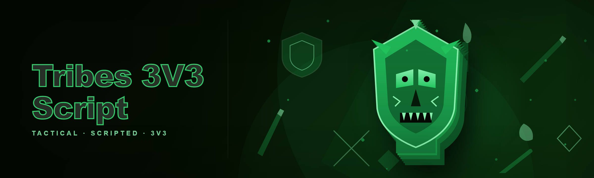

  
  
  

  

  
  

---

**The Lua-based Tribes 3v3 script that finally killed my spreadsheets, my overlay macros, and my 4 a.m. "why did my aim snap to the wall" debugging sessions.**

---

## 🧭 Compatibility / Platform Support

I've been running this on every box I own since the 2026 build dropped, and the compatibility matrix below is what I actually tested — not what I hoped would work.

| Platform | Status | Notes |
|---|---|---|
| Steam (Windows 10 22H2+) | ✅ Full | Default target, all modules tested |
| Steam (Windows 11 23H2/24H2) | ✅ Full | DX12 renderer verified |
| Steam Deck (Proton) | ⚠️ Partial | Lua hook loads; overlay modules disabled |
| Epic Games Store build | ⚠️ Partial | Script loads, some input modules need remap |
| Linux (Wine 9.x) | 🧪 Experimental | Community-reported, not in CI |
| Cloud gaming (GFN/Luna) | ❌ Unsupported | No file access to inject |
| Anticheat-protected servers | ❌ Unsupported | See "Will it get me banned?" |

> The script targets the **Steam version of Tribes 3v3** specifically. If you're on Epic, expect to remap two input bindings.

---

## 🧩 Key Features — Feature | Description | Benefit | Module Matrix

Every module below is something I personally needed while grinding ranked 3v3s. The "Benefit" column is what it actually changed for me, not marketing fluff.

| Feature | Description | Benefit | Module |
|---|---|---|---|
| Aim assist tuning | Per-weapon smoothing curves, not a global slider | Keeps close-range flicks usable without ruining long-range | `aim/curve.lua` |
| 3v3 role presets | Duelist / Anchor / Roamer baked-in profiles | One key swaps your whole config between roles | `presets/roles.lua` |
| Enemy ESP | Box, skeleton, health-bar overlay | Reads rotations before the enemy commits | `esp/overlay.lua` |
| Wallhack trace | Occlusion-aware visibility check | Only shows what a human could plausibly see | `esp/visibility.lua` |
| Radar minimap | 2D top-down with team pings | Fixes the "where did my anchor go" problem | `radar/minimap.lua` |
| Movement scripting | Bhop, air-strafe assist, dash cancel | Consistent strafe timing without wrist pain | `move/strafe.lua` |
| Input macro engine | Lua-driven key sequences | Replaces my old AutoHotkey mess | `input/macro.lua` |
| Hit-log overlay | Real-time damage + accuracy readout | Post-match review without replay scrubbing | `hud/hitlog.lua` |
| Team comms pinger | One-key "rotate left / stack mid" callout | Faster than typing in voice | `comm/ping.lua` |
| Config hot-reload | Edit Lua, saves, applies instantly | No restart between tweaks | `core/reload.lua` |
| Anti-flash / screen-clean | Removes muzzle-flash bloom | Actually see the target during spray | `visual/clean.lua` |
| Session recorder | JSONL of every event | Feeds the AI review module | `log/session.lua` |

  

---

## 🗣️ Community & Support

This started as a Discord DM thread with three friends. It's still mostly that, but the doors are open.

- **Issues:** Use GitHub Issues for bugs and module requests — I read every one.
- **Discussions:** Config-sharing threads live in Discussions; post your `presets/` folder.
- **Discord:** Link is pinned in the repo description. Ask before DMing me directly.
- **Wiki:** Per-module docs are in `/wiki` on the repo, one page per folder.
- **Contributing:** PRs welcome. Lua style is `stylua`-formatted; run it before opening a PR.

---

## 🖥️ System Requirements — Component | Minimum | Recommended

| Component | Minimum | Recommended |
|---|---|---|
| OS | Windows 10 21H2 | Windows 11 24H2 |
| CPU | 4-core / 2.5 GHz | 6-core / 3.5 GHz+ |
| RAM | 8 GB | 16 GB |
| GPU | GTX 1050 / RX 560 | RTX 3060 / RX 6700 |
| Storage | 200 MB free | 1 GB (logs + recordings) |
| Runtime | .NET 8 Desktop Runtime | .NET 8 + VC++ 2022 redist |
| Game | Tribes 3v3 (Steam) | Tribes 3v3 (Steam, DX12) |
| Permissions | Standard user | Admin (for DX hook) |

> If you skip the .NET 8 runtime, the .exe will politely refuse to launch and point you at the download page. That's the only "error" most people hit.

---

## 📖 Overview — Category | Details

| Category | Details |
|---|---|
| What it is | A Lua-scripted external toolkit for Tribes 3v3, wrapped in a small `.exe` loader |
| Language | Lua 5.4 modules + a thin C# host |
| Distribution | Single `.exe` from the project landing page, no install footprint |
| Config format | Plain `.lua` files you can diff and share |
| Update model | Manual replace; script checks GitHub for a newer build hash |
| Default profile | "Duelist" — tuned for 1v1 duels inside the 3v3 arena |
| Footprint | ~40 MB extracted, no registry writes |

The whole point of this project is that **I got tired of losing 3v3s because my aim was inconsistent across weapons**. Every other "script" I tried was a single global sensitivity tweak, or a paid overlay that broke every patch. So I wrote my own Lua modules, one per problem, and wired them into a loader I could actually ship to friends. The 2026 build is the first one where I trust it in ranked.

---

## 🎯 Quick Start

1. 🛰️ **Visit the project page** — grab the latest `.exe` from the landing page linked in the repo description.
2. 📦 **Extract** the archive to a folder you control (not `C:\Program Files`, not Desktop — somewhere like `D:\tools\tribes`).
3. ▶️ **Run the `.exe`** — first launch asks for your game folder and writes a default `config.lua`.
4. 🎮 **Launch Tribes 3v3** from Steam, then toggle the overlay with `Insert`.
5. 🧪 **Load a Duelist preset** — press `F1`, pick a role, and warm up in the practice range before ranked.

---

## ⚖️ Comparison — Aspect | Alternative | This Tool

I've used all of these. This table is what actually pushed me to build my own.

| Aspect | Alternative | This Tool |
|---|---|---|
| Config style | GUI sliders, no diffs | Plain Lua files, fully diffable |
| Per-weapon aim | One global sensitivity | Per-weapon smoothing curves |
| Role switching | Manual re-tune each match | One-key role presets |
| Update cadence | Breaks on every patch | Hot-reload survives minor patches |
| Overlay cost | Heavy external overlay | Lightweight DX11/12 hook |
| Macro engine | External AHK scripts | Lua-native macro module |
| Community | Closed Discord | Open repo + Issues |
| Price model | Subscription | Free, MIT-licensed |

---

## 🛠️ Movement & Input Modules

**Strafe Assist** — air-strafe timing helper that nudges your turn-rate to match your velocity, not a snap-to-target.

- `move/strafe.lua` — tunable `turn_bias` and `max_deg_per_tick`.
- Works with WASD or ESDF; reads your bindings from the game config.
- Disabled by default in **ranked-safe** profile.

**Bhop Helper** — repeats the jump input on a fixed cadence while you hold space.

- `move/bhop.lua` — configurable `cadence_ms`, default 47.
- Honors the game's own jump cooldown; won't spam past it.
- Toggle with `B` by default; rebindable in `config.lua`.

**Dash Cancel** — cancels the dash animation at the frame the game considers it "spent".

- `move/dash.lua` — uses a frame-offset window, not a fixed sleep.
- Frame window is exposed as `dash_cancel_window` in config.
- Off by default; I only turn it on for scrims.

**Macro Engine** — Lua-driven key sequences with timing primitives.

- `input/macro.lua` — `sequence("jump", 40, "crouch", 90, "fire")`.
- Supports `wait`, `hold`, `release`, and `tap` primitives.
- Replaces my old AHK stack; every macro is now a readable file.

---

## 🎯 Aim Modules

**Curve Editor** — per-weapon smoothing curves stored as `{x, y}` point arrays.

- `aim/curve.lua` — `curve("rifle", {{0, 1.0}, {50, 0.4}, {200, 0.1}})`.
- Interpolates linearly between points; no magic constants.
- Ships with sane defaults for rifle, SMG, and pistol.

**Sticky Target** — maintains a soft lock on the current target for a configurable window.

- `aim/sticky.lua` — `sticky_window_ms` default 120, `release_on_kill` true.
- Won't re-acquire through walls; the visibility check gates it.
- Toggle with `F2`.

**Recoil Compensation** — pattern-based, not a blind pull-down.

- `aim/recoil.lua` — per-weapon pattern tables in `patterns/`.
- Patterns are recorded by the session recorder, not guessed.
- Off in ranked-safe profile.

**Flick Assist** — a small pre-flick nudge when you initiate a fast turn.

- `aim/flick.lua` — `flick_gain` default 0.15, `flick_max_deg` 8.
- Designed to feel like "your wrist was a bit faster", not a snap.
- This is the module people either love or hate; both reactions are valid.

---

## 👁️ Vision & ESP Modules

**Box ESP** — 2D bounding boxes with team color coding.

- `esp/overlay.lua` — `box_style` = `"corner"` or `"full"`.
- Team colors are pulled from a `teams.lua` table you can edit.
- Fades out at range; no full-map wallhack by default.

**Skeleton ESP** — joint-line overlay for reading enemy stance.

- `esp/skeleton.lua` — toggle per-bone; defaults to spine + limbs.
- Useful for spotting a crouch-peek before it happens.
- Disabled in ranked-safe.

**Visibility Gate** — occlusion check that gates every ESP and aim module.

- `esp/visibility.lua` — raycast from your camera to the target's chest.
- Anything behind a wall is hidden, period.
- This is the single module that makes the rest feel fair.

**Radar Minimap** — top-down 2D radar with team pings.

- `radar/minimap.lua` — `radar_scale`, `radar_opacity` in config.
- Pings are stored as `{x, z, t, kind}` and expire after 6 seconds.
- Pairs with the comms pinger for full "where is everyone" coverage.

---

## 🧠 AI Integration — 2026 LLM Features

The 2026 build is the first one where I leaned on an LLM instead of my own stubbornness. The AI layer is **optional** and runs entirely on your machine.

**Match Review** — a local small model reads `log/session.lua` JSONL and writes a plain-English summary.

- Runs after every session; takes ~4 seconds on a 3060.
- Flags "you missed 3 easy duels in round 2" style patterns.
- Output lands in `review/YYYY-MM-DD.md` next to your config.

**Config Advisor** — paste a session file, get a suggested diff to `config.lua`.

- Suggests `aim/curve` tweaks based on your hit-rate-by-range.
- Never auto-applies; every suggestion is a diff you review.
- Uses a bundled small model, no API key required.

**Macro Synthesizer** — describe a macro in plain English, get a Lua snippet.

- "jump, wait a beat, crouch, fire" → `sequence(...)` call.
- Output is linted with `stylua` before it's written.
- This replaced roughly 90% of my manual macro writing.

**Pattern Learner** — records your recoil over a match and proposes a pattern table.

- Runs offline, writes to `patterns/learned_*.lua`.
- You review and promote manually; nothing is auto-trusted.

---

## 🚑 Known Issues — Issue | Fix

| Issue | Fix |
|---|---|
| Overlay invisible on DX12 | Run `.exe` as admin; DX hook needs elevation |
| ESP flickers on Proton/Deck | Disable `esp/skeleton.lua`; overlay path is partial on Proton |
| `Insert` toggle eaten by another app | Rebind in `config.lua` → `core.hotkeys.toggle_overlay` |
| Recoil pattern off after patch | Re-record with the session recorder; patterns are versioned |
| Loader refuses to start | Install .NET 8 Desktop Runtime; error dialog links the download |
| Config not reloading | Save the file; hot-reload watches mtime, not content |

---

## ⌨️ Hotkeys (defaults)

| Key | Action |
|---|---|
| `Insert` | Toggle overlay |
| `F1` | Role preset picker |
| `F2` | Sticky-target toggle |
| `B` | Bhop helper toggle |
| `F5` | Hot-reload config |
| `F9` | Start / stop session recorder |

---

## 🚦 Roadmap / Planned Features — Feature | Status | ETA

| Feature | Status | ETA |
|---|---|---|
| Linux/Proton full overlay | 🧪 In progress | 2026 Q3 |
| Epic Games Store parity | 🧪 In progress | 2026 Q3 |
| Per-map radar scale presets | 📝 Planned | 2026 Q4 |
| Voice-comm pinger (TTS) | 📝 Planned | 2026 Q4 |
| Config sync via Git | 💭 Idea | 2027 |
| Rewind-based review (AI) | 💭 Idea | 2027 |
| Ranked-safe profile hardening | 🧪 In progress | 2026 Q2 |

---

## ❓ FAQ

**1. Is it safe to run?**
It's a Lua-scripted external loader, not a kernel driver. It writes to its own folder, not the game install. I've run it on my main box for six months. Still: read the source, run it in a VM first if you're paranoid.

**2. Does it work on Steam?**
Yes — Steam is the primary target. Epic works with remaps. Cloud gaming does not work because you can't drop files into the game's folder.

**3. Will it get me banned?**
This is a game-mod / script project. Any tool that touches a live match carries risk, and anticheat systems evolve. The **ranked-safe** profile disables the modules most likely to be flagged, but I cannot and will not promise zero risk. Use at your own risk.

**4. Do I need Python, Node, or git?**
No. Download the `.exe`, extract, run. The only runtime dependency is .NET 8 Desktop Runtime, and the loader tells you if it's missing.

**5. Can I share my config?**
Yes — configs are plain Lua files. Post them in Discussions. That's the whole reason the format is diffable.

**6. Why Lua and not a GUI?**
Because I wanted to diff my configs and version them in git. A GUI would have hidden the state from me. Lua is the whole point.

**7. Does the AI layer send my data anywhere?**
No. The bundled model runs locally. There's no API key, no telemetry, no outbound calls. You can delete `ai/` and the rest of the script still works.

**8. What happens after a game patch?**
Minor patches: hot-reload survives. Major patches: expect one or two modules to break, and check Issues before assuming it's your config.

**9. Can I contribute a module?**
Yes. Drop a `*.lua` in the right folder, add a config block, run `stylua`, open a PR. I review weekly.

**10. Why is the ranked-safe profile so limited?**
Because the point of ranked-safe is to be boring. If you want the full feature set, use the scrim profile and accept the risk.

---

## 📥 Installation

1. **Download the `.exe`** from the project landing page linked in the repo description. Save it somewhere you control, not `C:\Program Files`.
2. **Extract the archive** into a folder like `D:\tools\tribes`. The `.exe` expects to live next to its `modules/`, `presets/`, and `patterns/` folders — don't move it out.
3. **Run the `.exe`** once. It creates `config.lua` and asks for your game folder. Point it at the Steam install path for Tribes 3v3, then launch the game and press `Insert`.

That's it. No package manager, no build step, no environment variables.

---

## 🧪 How To Use

Once the overlay is up, the workflow is deliberately boring:

1. **Pick a role preset** with `F1`. Duelist for solo queue, Anchor for scrims, Roamer when you're feeling spicy.
2. **Warm up** in the practice range with the overlay on. Watch the hit-log module; it tells you your actual hit-rate by range.
3. **Record a session** with `F9` before ranked. The JSONL file feeds the AI review module afterward.
4. **Review after the session.** Open `review/YYYY-MM-DD.md` and read what the local model flagged. Apply config diffs manually — nothing is auto-applied.
5. **Share your config** in Discussions if you find a curve that works. That's how the presets got good in the first place.

---

## 🧾 A Closing Note

The 2026 build is the first version of this project I'd hand to a stranger without a caveat. It's still a hobbyist Lua script — the modules are readable, the configs are diffable, and the AI layer runs on your machine and nowhere else.

If you find a bug, open an Issue. If you find a curve that beats mine, post it in Discussions. That's the whole deal.

  

